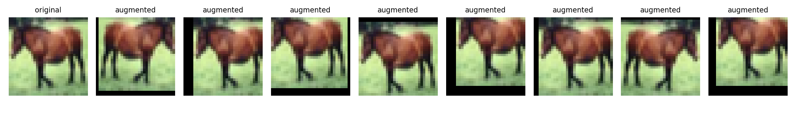
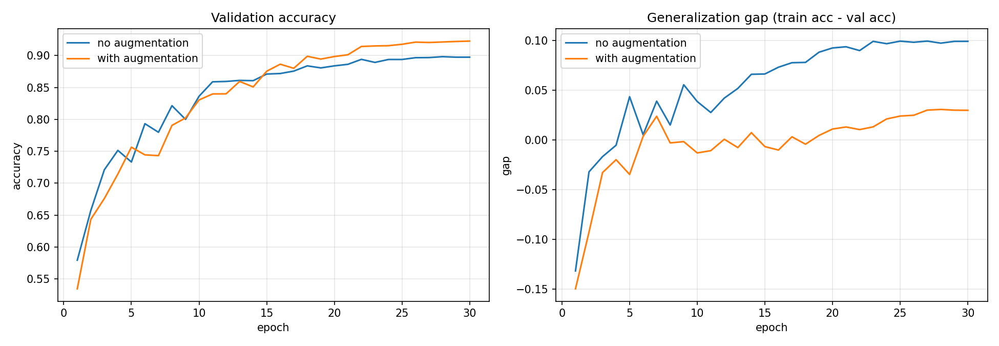
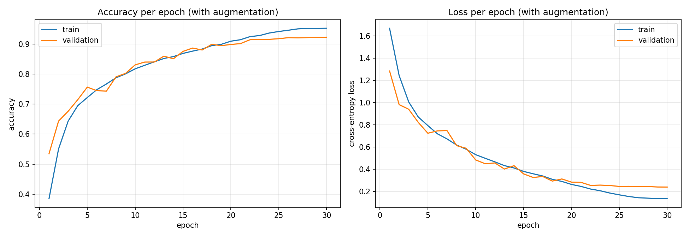

# ML-9: CNN for Image Classification (CIFAR-10)

A VGG-style Convolutional Neural Network (PyTorch) trained on CIFAR-10, building on the neural-network fundamentals from ML-8.

## Results
| Model | Best val acc | **Test acc** |
|---|---|---|
| CNN, no augmentation | 89.82% | 89.09% |
| CNN + augmentation (final) | 92.26% | **91.82%** |

Target: >= 85% test accuracy. Test set (10,000 images) was used only once, for the final evaluation. Weights were selected on the validation set.

## Architecture
- 3 conv blocks: [Conv3x3 -> BatchNorm -> ReLU] x2 -> MaxPool -> Dropout (64 -> 128 -> 256 channels, dropout 0.1 / 0.2 / 0.3)
- Fully connected head: Flatten -> Linear(4096, 512) -> BatchNorm -> ReLU -> Dropout(0.5) -> Linear(512, 10)
- Loss: cross-entropy | Optimizer: AdamW (weight decay 5e-4) with OneCycleLR (max lr 2e-3) | 30 epochs, batch 128, mixed precision
- Split: 45,000 train / 5,000 validation / 10,000 test (seed 42)
- Augmentation: random crop (padding 4) + random horizontal flip

## Data augmentation

Without augmentation the model reaches 89.09% on test; with augmentation 91.82% (a change of +2.73 points). The right plot shows how the train-val gap behaves in both runs.

## Training curves

## Confusion matrix & errors

Most-confused pairs (true -> predicted): cat -> dog (94); dog -> cat (66); truck -> automobile (35). Easiest class: **automobile**, hardest: **cat**. The model tends to confuse visually similar animal classes (e.g. cat/dog), which look alike at 32x32 resolution.

## What got me from the first attempt to 85%+
1. First attempt: plain conv + pooling network without regularization overfit (train acc far above val acc).
2. Added BatchNorm after every conv, which made training faster and more stable.
3. Added Dropout (increasing with depth) to reduce overfitting.
4. Added random crop + flip augmentation, which improved generalization.
5. Used AdamW + OneCycle learning-rate schedule.

## Reproduce
Open `cnn_cifar10.ipynb` in Google Colab (GPU runtime) and run all cells. Numbers are in `results.json`; small run-to-run variation (~0.2-0.5%) is normal on GPU.
